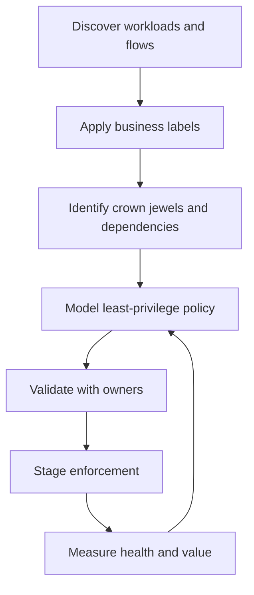

# Zero Trust Segmentation TAM Playbook

This repository is a vendor-neutral customer adoption playbook for a fictional regulated insurer moving from broad network trust to workload-level segmentation across on-premises, Azure and AWS environments.

It is designed to demonstrate how a Technical Account Manager connects security architecture, customer operating models, safe technical change and measurable business value. It is not an implementation of any commercial product and contains no customer or proprietary data.

## Customer scenario

Northstar Mutual is a fictional UK insurer with:

- on-premises policy-administration and payment systems;
- customer portals and APIs in Azure;
- analytics workloads in AWS;
- third-party support connections;
- regulatory obligations covering resilience, access control and audit evidence.

The organisation wants to reduce lateral-movement risk without disrupting critical services. Its immediate priorities are to map dependencies, identify crown-jewel applications, introduce a consistent label model, ring-fence critical workloads and create an operating model that the infrastructure, application and SOC teams can sustain.

## Target operating concept

## Repository contents

| Path | Purpose |
| --- | --- |
| [target-architecture.md](target-architecture.md) | Hybrid architecture and trust-boundary model |
| [workloads.csv](workloads.csv) | Fictional workload inventory and labels |
| [policy-matrix.csv](policy-matrix.csv) | Example provider-consumer rules with business justification |
| [90-day-adoption-plan.md](90-day-adoption-plan.md) | Structured onboarding, adoption and optimisation plan |
| [engagement-cadence.md](engagement-cadence.md) | Repeatable TAM operating rhythm and ownership model |
| [qbr-scorecard.md](qbr-scorecard.md) | Executive-ready health, risk and value measures |
| [escalation-runbook.md](escalation-runbook.md) | Customer escalation and recovery model |
| [vendor-neutral-decision-matrix.md](vendor-neutral-decision-matrix.md) | Outcome-led comparison framework |
| `references.md` | Public sources used to validate terminology |

## TAM principles demonstrated

1. Start with customer outcomes and operating constraints, not product features.
2. Treat visibility and dependency accuracy as prerequisites for safe enforcement.
3. Make application owners accountable for validating business flows.
4. Introduce controls progressively, with documented rollback and exception handling.
5. Translate platform signals into risk, resilience and operational confidence.
6. Track adoption and value through a repeatable customer-success cadence.

## Two-minute walkthrough

The customer has a hybrid estate and wants to limit the blast radius of a compromised workload. The playbook begins with dependency mapping and a Role-Application-Environment-Location label model. Critical flows are documented in a provider-consumer policy matrix and validated by application owners before staged enforcement. The TAM plan then turns the technical design into a sustainable engagement: agreed outcomes, health reviews, adoption milestones, escalation ownership and executive value reporting.

The purpose is not to claim product implementation experience. It shows how a TAM can help a customer move safely from segmentation intent to measurable operational value.

## Scope and integrity

- The customer and workload data are fictional.
- The playbook does not claim access to an Illumio PCE or production deployment.
- Illumio terminology is cross-checked against public product documentation.
- Product selection remains customer-led; the comparison section is not a vendor battlecard.
