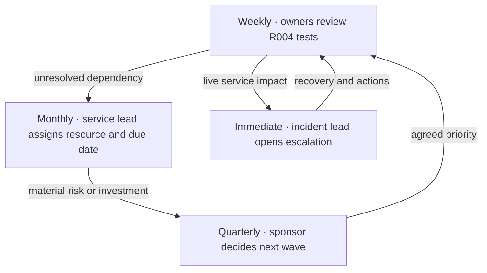

# TAM engagement cadence

The cadence keeps technical activity aligned to customer priorities and turns isolated product interactions into a sustained success programme.

## Weekly technical review

- Platform health, support cases and immediate risks.
- Workload onboarding, label quality and adoption blockers.
- Policy or architecture changes planned for the next two weeks.
- Decisions, owners and due dates.

## Monthly operational review

- Progress against the joint success plan.
- Adoption and platform-maturity movement.
- Recurring incident or support patterns.
- Enablement needs and customer capability development.
- Risks requiring sponsor or cross-functional intervention.

## Quarterly business review

- Customer objectives and material business changes.
- Outcomes achieved and evidence of technical value.
- Resilience, risk-reduction and operational-confidence measures.
- Strategic roadmap, upgrade and feature-adoption decisions.
- Renewal or expansion readiness where it reflects genuine customer value.

## Event-driven engagement

Additional reviews are triggered by:

- significant incidents or repeated support friction;
- major application migrations or architecture changes;
- product upgrades and policy-model changes;
- mergers, acquisitions or new regulatory scope;
- executive concern about delivery, risk or realised value.

## Ownership model

| Party | Primary contribution |
| --- | --- |
| Customer sponsor | Business outcomes, priority and organisational support |
| Customer technical owner | Architecture, operational decisions and change ownership |
| TAM | Strategic technical guidance, health, adoption, risks and orchestration |
| Customer Success | Relationship health, success alignment and commercial coordination |
| Professional Services | Scoped implementation and specialist delivery |
| Support | Product incident diagnosis and resolution |
| Engineering/Product | Defects, roadmap feedback and complex product decisions |

The TAM maintains context and continuity across these teams without pretending to replace their specialist responsibilities.

## How a decision travels

For example, a missing reconciliation owner goes on the weekly action log. The monthly service lead assigns one. If live reconciliation fails during the pilot, the TAM invokes the escalation runbook immediately.
