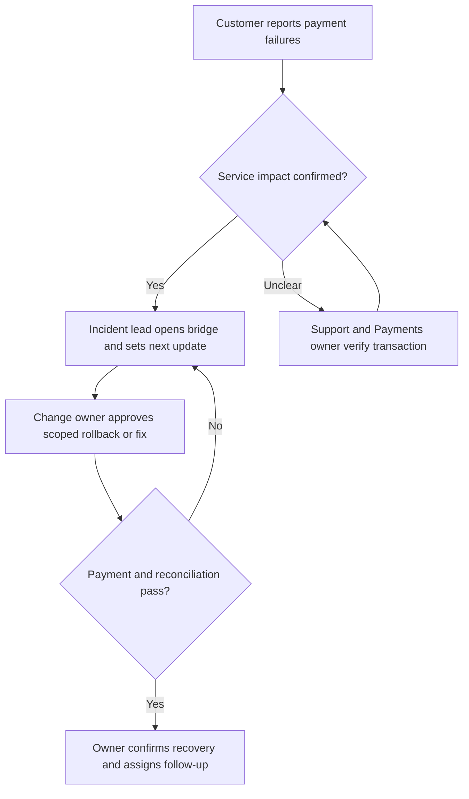

# Customer escalation runbook

## Objective

Restore customer confidence and service safely while maintaining clear technical ownership, evidence and communication.

## 1. Acknowledge and stabilise

- Confirm business impact, affected services and customer priority.
- Establish a single incident owner and customer communication lead.
- Preserve evidence and identify recent changes.
- Apply only approved containment, rollback or exception actions.

## 2. Mobilise the right teams

- Engage Support at the appropriate severity.
- Bring in Engineering, Professional Services, cloud/network teams or application owners according to the evidence.
- Record decisions, owners, dependencies and next update time.

## 3. Communicate without speculation

- State what is known, what remains unconfirmed and what is being tested.
- Translate technical status into business impact.
- Maintain an agreed communication cadence even when there is no major change.

## 4. Recover and validate

- Confirm service recovery with technical monitoring and the customer owner.
- Check for unintended access, policy gaps or temporary exceptions.
- Keep heightened monitoring until agreed stability criteria are met.

## 5. Learn and prevent recurrence

- Lead a blameless root-cause and corrective-action review.
- Separate product defect, configuration, process, skills and dependency factors.
- Assign corrective actions with owners and target dates.
- Feed relevant learning into health reviews, enablement and future change plans.

## TAM behaviour

The TAM does not replace Support or Engineering. The TAM maintains customer context, coordinates accountability, anticipates risks, removes communication gaps and ensures that corrective actions improve long-term platform maturity.

## Payment pilot escalation

| Measure | Start and stop | Who acts |
| --- | --- | --- |
| Time to acknowledge | First report to named incident owner acknowledging impact | TAM escalates missed customer-agreed response target to the support lead. |
| Update reliability | Updates delivered by the agreed time divided by updates due during the incident | TAM agrees a revised cadence with the customer if an update is missed. |
| Time to restore | First confirmed disruption to Payments owner validating service recovery | Incident lead keeps the bridge open through validation. |
| Corrective actions overdue | Open actions past their agreed dates at weekly review | Action owners provide dates and the TAM escalates overdue material risks. |

For a suspected security incident, involve the customer incident-response lead and preserve evidence alongside service restoration. NIST SP 800-61 Rev. 3 informs detection, response, recovery and improvement. The customer agrees severity thresholds and communication times. [NIST incident response guidance](https://doi.org/10.6028/NIST.SP.800-61r3)
