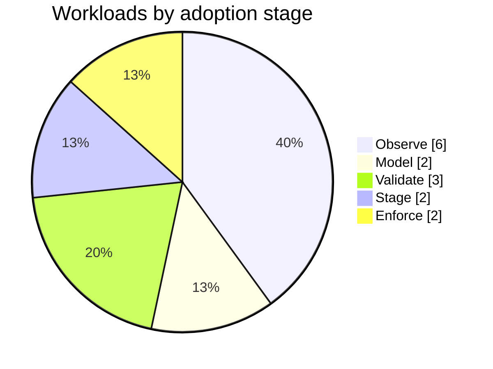

# QBR scorecard

The scorecard connects technical progress to customer outcomes. Thresholds should be agreed with the customer rather than imposed as universal targets.

| Area | Example measure | Executive meaning |
| --- | --- | --- |
| Coverage | Critical workloads discovered and assigned to owners | Confidence in the estate baseline |
| Data quality | Workloads with validated Role, Application, Environment and Location labels | Reliability of policy and reporting |
| Adoption | Priority applications progressing through observe, model, validate and enforce stages | Movement from purchase to operational use |
| Risk reduction | Unnecessary high-risk paths removed or controlled | Reduced lateral-movement opportunity |
| Resilience | Crown-jewel applications with validated containment boundaries | Smaller potential blast radius |
| Operational health | Platform-health risks and recurring support patterns | Sustainability and confidence at scale |
| Enablement | Customer teams able to operate agreed workflows independently | Reduced dependency and stronger adoption |
| Governance | Risks, decisions and exceptions with named owners and dates | Clear accountability and audit evidence |
| Value | Customer objectives achieved or advanced | Evidence supporting renewal and expansion confidence |

## QBR narrative

1. Restate the customer’s security and business priorities.
2. Show progress against the jointly agreed success plan.
3. Explain material risks, decisions and support patterns.
4. Connect technical changes to resilience, compliance and operational confidence.
5. Agree the next outcomes, owners and dates.

Avoid treating feature consumption as value by itself. Adoption is meaningful when it changes the customer’s risk or operating capability.

## Kairos Yukton pilot snapshot

The counts below come from the fictional inventory and matrix. Read the chart as workload counts in mutually exclusive stages. A host at Stage may have only one service under enforcement.

| Sponsor question | Snapshot | Evidence and decision |
| --- | --- | --- |
| How much of the estate is in routine enforcement? | 2 of 15 workloads (13%). | Count Enforce in the inventory. Both are supporting workloads. |
| Are the two crown jewels protected? | 0 of 2 at Enforce. W006 is at Validate and W008 at Stage. | Test R004 before expanding payments. Request owner sign-off for R003. |
| Which policies directly protect these databases? | 2 of 9 rules name a direct crown-jewel destination. Neither rule has reached Enforce. | R003 covers W006 and R004 covers W008. Review broad management and monitoring groups separately. |
| Can the sponsor approve the next wave? | Pending business transaction and denied-path test evidence. | Bring the change record, exception owner and rollback result to the next review. |

At the next QBR compare the same scope with the dated baseline. Show newly discovered assets separately so that a changing denominator is visible.
