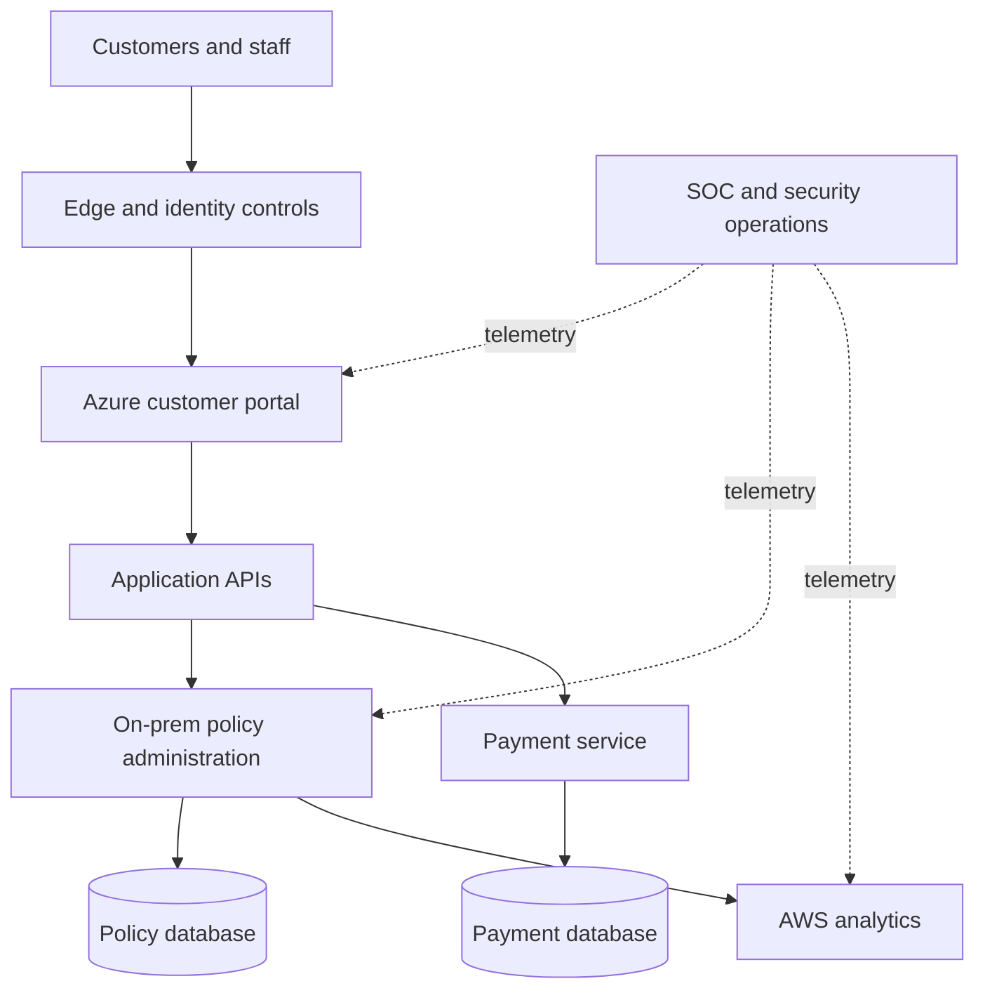

# Target architecture

## Design intent

Northstar Mutual requires a consistent segmentation model across its data centre, Azure and AWS environments. Policy should follow workload purpose rather than depend only on network location or IP address.

## Trust boundaries

- Internet-facing workloads must not initiate unrestricted connections to internal tiers.
- Application tiers may reach only documented services on their corresponding data tiers.
- Production and non-production environments are isolated by default.
- Administrative access is permitted only through managed access services.
- Analytics receives approved data flows and cannot initiate access to transactional databases.
- Third-party connectivity is time-bound, monitored and restricted to approved services.

## Label model

| Dimension | Example values | Customer purpose |
| --- | --- | --- |
| Role | Web, API, Application, Database, Management | Describes workload function |
| Application | CustomerPortal, PolicyAdmin, Payments, Analytics | Associates workloads with a business service |
| Environment | Production, UAT, Development | Prevents accidental cross-environment trust |
| Location | DataCentre, Azure-UK, AWS-UK | Provides deployment context without binding policy to IP addresses |

## Safe implementation pattern

1. Observe and baseline traffic.
2. Resolve unknown assets and ownership.
3. Validate labels with application and infrastructure owners.
4. Model explicit provider-consumer rules.
5. Test policy impact and document exceptions.
6. Enforce one application boundary at a time.
7. Monitor service health, blocked flows and support trends.
8. Record lessons and apply them to the next application wave.
