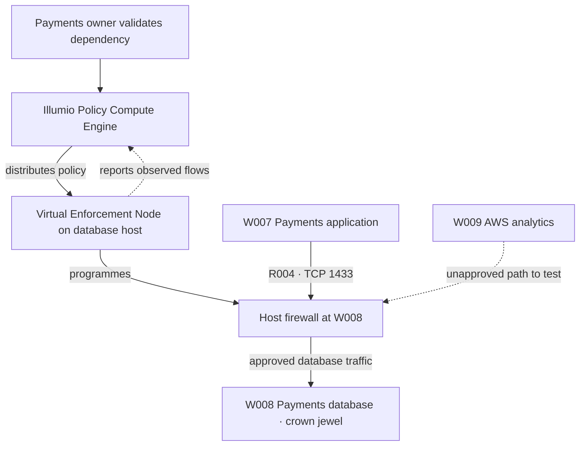

# Target architecture

## Design intent

Kairos Yukton requires a consistent segmentation model across its data centre, Azure and AWS environments. Policy should follow workload purpose rather than depend only on network location or IP address.

The pilot starts with the payment database, W008. A payment application needs one database service. An analytics workload has no approved business reason to reach it. An address inside the data centre grants neither workload permission by itself.

**Where microsegmentation happens.** The host firewall is the boundary around the database service. The PCE calculates policy from labels and rules. The VEN reports flow information and applies policy using the host firewall. Application traffic travels to the database host. The dotted analytics path is a negative test for the pilot. Its outcome requires observation at the enforcement point.

**Where Zero Trust fits.** Explicitly authorise the application-to-database connection using workload context. The application must still authenticate to the database and use an appropriately scoped account. Segmentation controls reachability. Identity, authorisation and monitoring continue to protect the resource. [NIST SP 800-207](https://doi.org/10.6028/NIST.SP.800-207) · [Illumio Security Policy Guide](https://product-docs-repo.illumio.com/Tech-Docs/Core/PDFs/Security_Policy_25_2.pdf)

**Go/no-go.** During the change window, the Payments owner runs a representative transaction and reconciliation check. Operations verifies that the unauthorised path is denied within pilot scope. A failed business check pauses expansion and triggers the approved rollback.

## Trust boundaries

- Internet-facing workloads must not initiate unrestricted connections to internal tiers.
- Application tiers may reach only documented services on their corresponding data tiers.
- Production and non-production environments are isolated by default.
- Administrative access is permitted only through managed access services.
- Analytics receives approved data flows and cannot initiate access to transactional databases.
- Third-party connectivity is time-bound, monitored and restricted to approved services.

## Label model

| Dimension | Example values | Customer purpose |
| --- | --- | --- |
| Role | Web, API, Application, Database, Management | Describes workload function |
| Application | CustomerPortal, PolicyAdmin, Payments, Analytics | Associates workloads with a business service |
| Environment | Production, UAT, Development | Prevents accidental cross-environment trust |
| Location | DataCentre, Azure-UK, AWS-UK | Provides deployment context without binding policy to IP addresses |

## Safe implementation pattern

1. Observe and baseline traffic.
2. Resolve unknown assets and ownership.
3. Validate labels with application and infrastructure owners.
4. Model explicit provider-consumer rules.
5. Test policy impact and document exceptions.
6. Enforce one application boundary at a time.
7. Monitor service health, blocked flows and support trends.
8. Record lessons and apply them to the next application wave.
